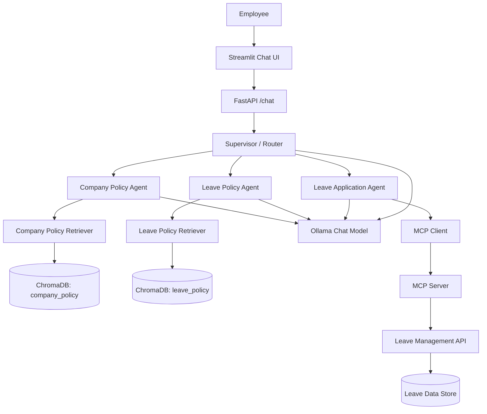

# HR Multi-Agent Assistant

## 1. Project Overview

The HR Multi-Agent Assistant is a Python-based application that answers
employee questions about company policies, explains leave rules, and
supports leave applications through an API-backed workflow.

The project uses Retrieval-Augmented Generation (RAG) for policy
knowledge, LangChain/LangGraph for agent orchestration, Ollama for local
language models, ChromaDB for vector storage, FastAPI for backend APIs,
an MCP server for exposing tools, and Streamlit for the user interface.

> **Project status:** Development / local testing. Confirm the actual
> installed package versions and implemented tools in the project before
> treating this document as a final implementation specification.

## 2. Main Capabilities

1.  Answer questions using the company handbook.
2.  Answer questions using the leave policy documents.
3.  Collect information needed to submit a leave request.
4.  Call leave-management tools through an MCP integration.
5.  Route a user's request to the appropriate agent.
6.  Maintain conversation context using a conversation ID.
7.  Provide an HTTP API and a Streamlit chat interface.

## 3. Agents

### 3.1 Supervisor / Router Agent

**Purpose:** Determines which specialist should handle the user's
request and routes it accordingly.

**Typical responsibilities:** - Identify whether the question concerns
company policy. - Identify whether the question concerns leave policy. -
Identify whether the user wants to perform a leave-related action. -
Pass the request and relevant conversation context to the selected
agent. - Return the specialist's response to the user.

**Example requests:** - "What are the company working hours?" - "How
many annual leave days do employees get?" - "I want to apply for leave."

**Implementation note:** Routing can be implemented with deterministic
rules or an LLM-based supervisor. The project should document which
approach is currently active.

### 3.2 Company Policy Agent

**Purpose:** Answers questions using the company handbook through RAG.

**Knowledge source:** `documents/company_policy/company_handbook.txt`

**Example topics:** - Working days and working hours. - Work-from-home
rules. - Expense claims. - Confidentiality requirements.

**Typical processing flow:** 1. Receive the user's question. 2. Retrieve
relevant handbook chunks from the `company_policy` Chroma collection. 3.
Provide the retrieved context and question to the language model. 4.
Return an answer grounded in the retrieved content. 5. Include source
information where available.

**Grounding rule:** If the handbook does not contain enough information,
the agent should say so instead of inventing a company rule.

### 3.3 Leave Policy Agent

**Purpose:** Answers questions about leave entitlements and leave
procedures using the leave policy documents.

**Knowledge source:** `documents/leave_policy/leave_rules.txt`

**Example topics:** - Annual leave entitlement. - Sick leave rules. -
Leave application requirements. - Approval process. - Leave balance
questions, where authoritative balance data is connected.

**Typical processing flow:** 1. Receive the user's leave-policy
question. 2. Retrieve relevant chunks from the `leave_policy` Chroma
collection. 3. Pass the retrieved context to the language model. 4.
Answer using the policy content. 5. Explain when the policy document
does not provide enough information.

**Important distinction:** Policy documents describe rules. An
employee's current leave balance should come from an authoritative HR
record or API, not be guessed from the policy RAG index.

### 3.4 Leave Application Agent

**Purpose:** Helps an employee prepare and submit a leave request using
leave-management tools.

**Expected information:** - Employee code. - Leave type. - Start date. -
End date. - Reason for leave.

**Typical workflow:** 1. Identify that the user wants to apply for
leave. 2. Ask for any required information that is missing. 3. Validate
the employee code and leave type using the backend. 4. Summarize the
proposed request. 5. Ask the employee to confirm before submission. 6.
Call the leave application tool through MCP. 7. Report the API result
and any request/reference identifier.

**Safety and correctness rules:** - Do not submit a request before the
employee has confirmed the details. - Do not claim that leave is
approved merely because a request was submitted. - The manager or HR
approval process remains authoritative. - Validate dates and leave type
on the backend. - Do not trust employee details supplied in free text
without backend validation.

## 4. Agent and Tool Responsibilities

---

Component Responsibility

---

Supervisor / Router Classifies and routes the request

Company Policy Agent Answers handbook questions using
RAG

Leave Policy Agent Answers leave-rule questions using
RAG

Leave Application Agent Collects details and coordinates
leave submission

Company Policy Retriever Searches company handbook vectors

Leave Policy Retriever Searches leave policy vectors

Leave API Validates and processes
leave-related operations

MCP Server Exposes backend operations as tools

MCP Client Connects agents to the MCP server
and invokes tools

---

A RAG chain and an agent are not identical. A RAG chain follows a
predefined retrieval-and-answer sequence. An agent can decide when to
call one or more tools, subject to its instructions and available model
capabilities.

## 5. Technology Stack

---

Area Technology Role

---

Language Python Application
implementation

Environment / package `uv` Virtual environment and
manager dependency management

LLM runtime Ollama Runs language models
locally

Chat model `llama3.2:1b` Generates responses;
(configured example) verify tool-calling
suitability

Embedding model `nomic-embed-text` Converts documents and
queries into vectors

Agent framework LangChain Prompts, models, tools
and agent components

Orchestration LangGraph Coordinates agents and
conversation workflow

RAG framework LangChain retrievers Retrieves relevant
policy chunks

Vector database ChromaDB Stores and searches
document embeddings

Backend API FastAPI Exposes application
endpoints

ASGI server Uvicorn Runs the FastAPI
application

Tool integration Model Context Protocol Exposes leave
(MCP) operations as tools

User interface Streamlit Chat interface for
employees

HTTP client HTTPX / Requests Makes API calls

---

The exact versions should be recorded from the active environment, for
example with `uv pip list` or the project's `pyproject.toml` and lock
file.

## 6. High-Level Architecture



## 7. Request Flows

### 7.1 Company Policy Question

Example: "What are the company working hours?"

1.  Streamlit sends the question to FastAPI.
2.  FastAPI passes the request to the supervisor.
3.  The supervisor selects the Company Policy Agent.
4.  The agent retrieves relevant handbook chunks from ChromaDB.
5.  Ollama generates an answer using the retrieved context.
6.  The answer is returned to Streamlit.

### 7.2 Leave Policy Question

Example: "How many annual leave days are allowed?"

1.  The supervisor selects the Leave Policy Agent.
2.  The agent searches the leave policy collection.
3.  The retrieved policy context is sent to the model.
4.  The agent returns an answer based on the policy document.

### 7.3 Leave Application

Example: "I want to apply for annual leave."

1.  The supervisor selects the Leave Application Agent.
2.  The agent collects employee code, leave type, dates and reason.
3.  The agent validates the request through available backend tools.
4.  The agent summarizes the request and asks for confirmation.
5.  After confirmation, the agent invokes the MCP leave tool.
6.  The Leave API processes the request.
7.  The result is returned to the employee.

## 8. Suggested Project Structure

```text
hr-multi-agent/
├── app/
│   ├── agents/
│   │   ├── supervisor.py
│   │   ├── company_policy_agent.py
│   │   ├── leave_policy_agent.py
│   │   └── leave_application_agent.py
│   ├── api/
│   │   ├── main.py
│   │   ├── leave_api.py
│   │   └── mcp_server.py
│   ├── mcp_client/
│   │   └── client.py
│   ├── rag/
│   │   ├── ingest.py
│   │   └── retrievers.py
│   ├── schemas/
│   │   └── leave.py
│   ├── database/
│   │   └── store.py
│   ├── config.py
│   └── main.py
├── documents/
│   ├── company_policy/
│   │   └── company_handbook.txt
│   └── leave_policy/
│       └── leave_rules.txt
├── ui/
│   └── streamlit_app.py
├── chroma_db/
├── .env
├── .gitignore
├── pyproject.toml
└── README.md
```

Adjust the structure to match the files that actually exist in the
repository. In particular, keep one clearly defined FastAPI entry point
and avoid having two competing `main.py` modules.

## 9. API and Local Service Endpoints

---

Service Local address Purpose

---

FastAPI `http://127.0.0.1:8000` Main backend

FastAPI Swagger `http://127.0.0.1:8000/docs` Interactive API testing

MCP server `http://127.0.0.1:8001/mcp` MCP Streamable HTTP
endpoint (if configured
this way)

Ollama `http://127.0.0.1:11434` Local model service

Streamlit `http://localhost:8501` HR chat UI

---

### Example ChatRequest

```python
from pydantic import BaseModel

class ChatRequest(BaseModel):
    query: str
    conversation_id: str | None = None
    employee_code: str | None = None
    leave_type: str | None = None
```

The request schema may need additional fields or a structured
leave-request object for start date, end date and reason.

### Example request body

```json
{
  "query": "How many annual leave days are allowed?",
  "conversation_id": "test-001"
}
```

## 10. Conversation Session Management

A simple local development implementation may use an in-memory
dictionary:

```python
sessions = {}

previous = sessions.get(conversation_id, {})
```

This allows the application to look up state using a conversation ID.
However:

- Data is lost when the process restarts.
- Separate Uvicorn workers do not share the same dictionary.
- It is not a durable production session store.

For a multi-instance or production deployment, use a shared store such
as Redis or a persistent database, or use a LangGraph checkpointer
configured with an appropriate storage backend.

## 11. RAG Ingestion and Retrieval

### Ingestion outline

1.  Load policy files from the `documents` directory.
2.  Split each document into manageable chunks.
3.  Generate embeddings using `nomic-embed-text` through Ollama.
4.  Store the chunks and metadata in separate Chroma collections.

Example collection names:

- `company_policy`
- `leave_policy`

Example local model setup:

```powershell
ollama pull llama3.2:1b
ollama pull nomic-embed-text
ollama list
```

Run the ingestion module using the actual module path in the project,
for example:

```powershell
uv run python -m app.rag.ingest
```

If the embedding model is missing, pull it before running ingestion.
Re-run ingestion whenever the source policy documents change, using a
process that avoids unintended duplicate chunks.

## 12. Running the Application Locally

Open separate PowerShell terminals from the project root.

**Terminal 1 -- Ollama**

Ensure the Ollama service is running. Check installed models:

```powershell
ollama list
```

**Terminal 2 -- MCP server**

```powershell
uv run python -m app.api.mcp_server
```

Keep this terminal running if the leave tools are served by this
process.

**Terminal 3 -- FastAPI**

Use the module path and FastAPI variable name that exist in your
project. Example:

```powershell
uv run uvicorn app.main:app --reload --port 8000
```

This command expects an `app` FastAPI instance inside `app/main.py`.

**Terminal 4 -- Streamlit**

```powershell
uv run streamlit run ui/streamlit_app.py
```

Open `http://localhost:8501` in a browser.

## 13. Testing Checklist

Test each layer independently before testing the complete chat workflow.

- [ ] Ollama is running and the configured chat model is available.
- [ ] `nomic-embed-text` is available.
- [ ] Policy ingestion completes successfully.
- [ ] Company policy retriever returns relevant handbook chunks.
- [ ] Leave policy retriever returns relevant leave-policy chunks.
- [ ] Company Policy Agent answers from retrieved context.
- [ ] Leave Policy Agent answers from retrieved context.
- [ ] MCP server starts and exposes the expected tools.
- [ ] MCP client can list and call the expected tools.
- [ ] Leave API validates employee code, leave type and dates.
- [ ] Leave application requires confirmation before submission.
- [ ] FastAPI `/chat` works through Swagger.
- [ ] Conversation context behaves as expected across requests.
- [ ] Streamlit can call FastAPI and display the answer.

## 14. Error and Troubleshooting Notes

### Ollama embedding model not found

Typical message:

```text
model 'nomic-embed-text' not found
```

Fix:

```powershell
ollama pull nomic-embed-text
ollama list
```

### Port 8001 already in use

Check which process is listening:

```powershell
Get-NetTCPConnection -LocalPort 8001 -State Listen
```

Identify the process before stopping it:

```powershell
Get-Process -Id <PID>
```

Only stop it if you have confirmed it is an old instance of your MCP
server.

### FastAPI reports that attribute `app` is missing

The command `uvicorn app.main:app` expects a variable named `app` in
`app/main.py`. Confirm the module path and variable name.

### HTTP 500 from `/chat`

The Swagger response alone may not reveal the root cause. Inspect the
full traceback in the terminal running Uvicorn. Check the supervisor,
RAG retriever, agent invocation, MCP connection and response parsing.

### Windows `WinError 10054`

This indicates that a TCP connection was reset by the remote side. It
may occur during client/server disconnect or when a service stops
unexpectedly. Determine which terminal reports it and whether the API
request actually failed before changing code.

## 15. Security and Production Considerations

- Keep API keys, passwords and database connection strings in
  environment variables or a secrets manager.
- Do not commit `.env` to source control.
- Use a strong, private session secret; do not use a sample secret in
  production.
- Authenticate employees and authorize access to their own leave
  records.
- Validate all inputs on the backend, even if the agent validates them
  first.
- Require explicit confirmation before performing leave submission or
  other state-changing actions.
- Add request IDs and structured logs to trace calls across FastAPI,
  agents, MCP and the leave API.
- Add timeouts and appropriate error handling for model and network
  calls.
- Use a persistent database for leave requests; an in-memory store is
  suitable only for a prototype.
- Treat retrieved documents and user-provided text as untrusted input.
- Do not let RAG content or user text override system instructions or
  backend authorization rules.
- Review retention and privacy requirements before storing
  conversation histories.

## 16. Current Prototype Limitations / Items to Verify

- Confirm whether the supervisor uses rule-based routing or LLM-based
  routing.
- Confirm that each specialist is implemented as a true tool-calling
  agent or as a fixed RAG chain. A fixed RAG chain is useful, but it
  should not be described as an autonomous agent.
- Verify that the selected Ollama model supports the tool-calling
  behavior required by the agent implementation. A small model such as
  `llama3.2:1b` may be limited for reliable tool selection.
- Ensure leave application collects start date, end date and reason in
  addition to employee code and leave type.
- Ensure leave submission is confirmed by the employee and is not
  represented as approved.
- Replace in-memory session and leave data with durable shared storage
  before multi-instance deployment.
- Confirm the MCP server URL, transport and tool names against the
  actual server configuration.
- Record tested dependency and model versions.

## 17. Glossary

---

Term Meaning

---

Agent A model-driven component that can
decide how to respond and, when
configured, use tools

Supervisor The component that selects or
coordinates specialist agents

RAG Retrieval-Augmented Generation;
retrieves relevant source content
before generating an answer

Embedding A numeric vector representation of
text used for semantic search

Retriever Searches a vector store for
relevant document chunks

ChromaDB A vector database used to store and
search embeddings

MCP Model Context Protocol; a standard
way to expose tools and context to
AI applications

Tool A callable operation an agent can
use, such as checking leave balance
or submitting a request

LangGraph A framework for defining stateful,
graph-based agent workflows

Conversation ID An identifier used to associate
messages with a conversation

---

---

**End of document**
